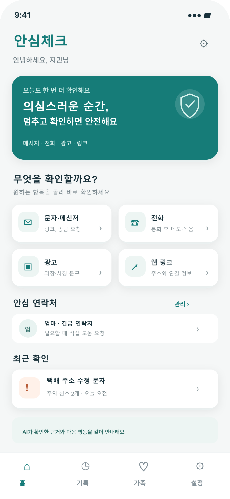
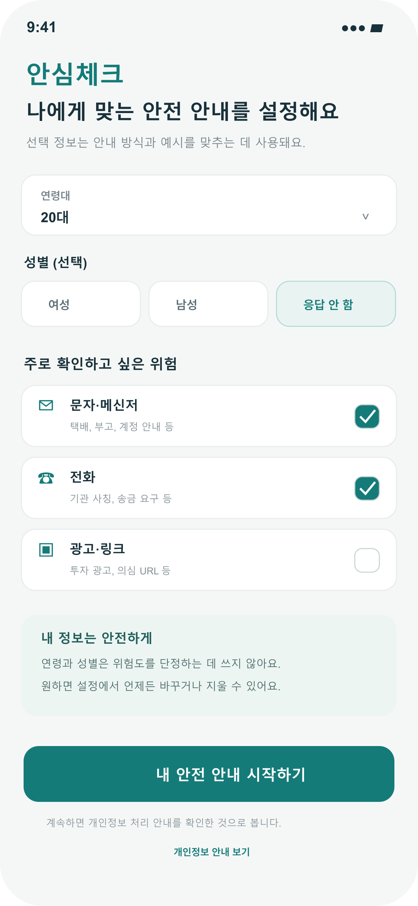
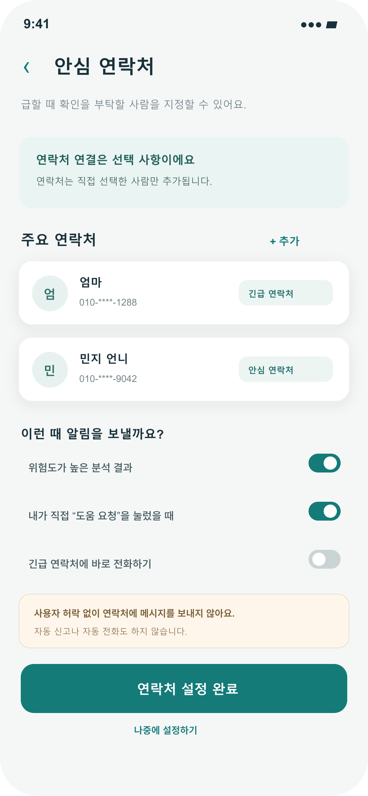
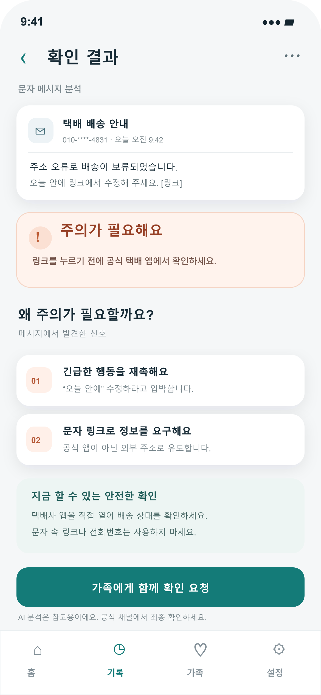
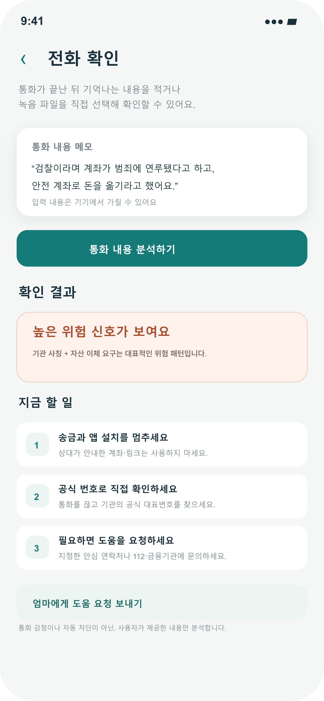
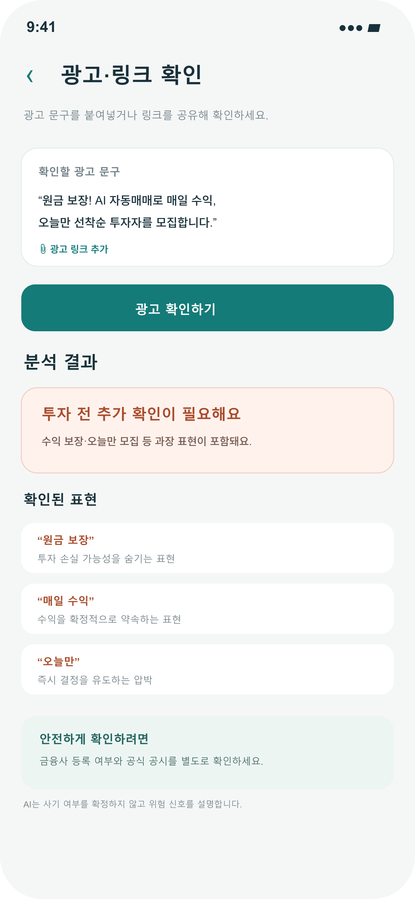
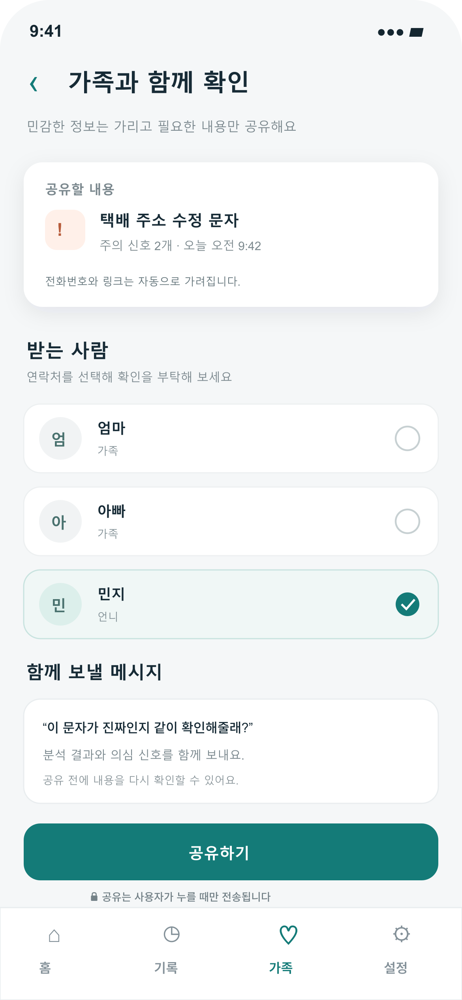

# 안심체크

> 의심스러운 순간, 잠시 멈추고 안전하게 확인하도록 돕는 AI 기반 아이폰 앱 기획 프로젝트

안심체크는 사용자가 직접 선택한 문자, 광고 문구, 링크 또는 통화 메모에서 의심 신호를 찾고, 왜 조심해야 하는지와 다음에 무엇을 확인하면 좋을지 안내하는 모바일 안전 도우미를 목표로 합니다.

현재 저장소는 **앱 기획 및 화면 시안 단계**입니다. 아래 기능과 기술은 구현 완료가 아니라 개발 목표와 설계 방향을 설명합니다.

## 문제와 개발 동기

생성형 AI와 딥페이크 기술이 빠르게 발전하면서 기관·가족 사칭, 스미싱, 투자·구인 광고 등에서 사용자가 의심스러운 내용을 구별하기 어려워질 수 있습니다. 안심체크는 사기 여부를 단정하는 대신, 위험 신호를 이해하고 공식 경로로 확인하도록 돕기 위해 기획했습니다.

초기 버전은 문자·광고 문구 분석에 집중합니다. **영상 딥페이크 자체를 판별하거나 피해를 완전히 막는 기능은 초기 개발 범위가 아닙니다.**

## 주요 기능 목표

- **문자 분석:** 사용자가 붙여넣거나 공유한 문자에서 링크 유도, 송금 요구, 급한 행동 요구 등의 신호와 근거를 표시합니다.
- **광고 확인:** 투자·구인 광고의 과장 표현이나 빠른 결정을 유도하는 문구를 살펴볼 수 있도록 돕습니다.
- **전화 메모 분석:** 통화 내용을 사용자가 직접 메모한 경우 기관 사칭, 송금 요구 등 주의 신호를 확인합니다. 통화 자동 감청이나 녹음은 목표 기능이 아닙니다.
- **안심 연락처:** 사용자가 직접 선택한 가족·지인에게 확인을 요청할 수 있도록 합니다. 연락처 전체를 가져오거나 자동으로 내용을 전송하지 않는 방향을 목표로 합니다.
- **안전한 다음 행동:** 문자 속 링크를 바로 누르기보다 공식 앱이나 대표번호로 직접 확인하도록 안내합니다.

## 사용 흐름

1. 사용자가 확인할 문자·광고·링크 또는 통화 메모를 선택합니다.
2. 앱이 의심 신호와 해당 근거를 보여줍니다.
3. 사용자가 공식 채널에서 확인하거나, 원하는 경우 안심 연락처에 도움을 요청합니다.

## 화면 시안

아래 이미지는 앱의 **기획용 시연 화면**이며 실제 앱 실행 화면은 아닙니다.

### 홈 화면

### 초기 설정 및 안심 연락처

<table>
  <tr>
    <td></td>
    <td></td>
  </tr>
</table>

### 문자·전화 확인

<table>
  <tr>
    <td></td>
    <td></td>
  </tr>
</table>

### 광고·가족 도움

<table>
  <tr>
    <td></td>
    <td></td>
  </tr>
</table>

## 유사 앱과 기획 방향

- **후후:** 발신자 정보와 스팸 전화·문자 확인 기능을 제공하는 국내 서비스입니다.
- **Whoscall:** 전화번호 식별과 스팸·사기 예방을 위해 문자, 링크, 스크린샷 등을 확인하는 기능을 소개하고 있습니다.

안심체크도 일부 기능이 기존 앱과 겹칠 수 있습니다. 기획상 차별화 방향은 단순히 위험 표시를 보여주는 데 그치지 않고 **의심 근거와 안전한 다음 행동을 쉬운 말로 설명하는 흐름**, 그리고 사용자가 선택했을 때만 가족 도움을 연결하는 경험입니다. 이 차별점은 개발 과정에서 실제 제품과 비교해 계속 검증할 예정입니다.

## AI 및 기술 설계 방향

초기에는 규칙 기반 점검과 작은 텍스트 분류 모델을 조합하는 방향을 고려합니다. 필요하면 Core ML을 이용해 분류 모델을 기기에서 실행하고, 이미지로 들어온 문구는 Vision OCR로 추출할 수 있습니다. AI는 사기 여부를 최종 확정하기보다 의심 신호와 근거를 설명하는 보조 도구로 사용합니다.

외부 생성형 AI를 추가한다면 서버를 거쳐 호출하고, 사용자의 동의와 개인정보 최소화를 우선 고려합니다. API 키를 iPhone 앱에 직접 넣지 않는 구조를 목표로 합니다. Apple Foundation Models 등 기기 내 모델은 지원 기기·운영체제에서 사용할 수 있는지 확인한 뒤 검토합니다.

### 개발 후보 기술

| 영역 | 후보 기술 | 사용 목적 |
|---|---|---|
| iPhone 앱 | Swift, SwiftUI | 화면과 사용자 흐름 구현 |
| 이미지 글자 인식 | Apple Vision | 사용자가 선택한 스크린샷에서 문자 추출 |
| 소형 분류 모델 | Create ML, Core ML | 의심 신호 분류를 기기에서 실행 |
| 설명 생성 | 기기 내 모델 또는 서버 기반 AI API | 분석 근거와 다음 행동을 쉬운 문장으로 안내 |

위 기술은 확정된 구현 스택이 아니라 **현재 검토 중인 선택지**입니다.

## iPhone에서의 개인정보·기능 범위

- 앱이 문자함 전체나 통화 내용을 몰래 읽거나 감청하지 않습니다.
- 사용자가 직접 붙여넣거나 공유한 정보부터 분석하는 흐름을 우선합니다.
- 안심 연락처는 사용자가 직접 선택하고, 도움 요청도 사용자가 시작하도록 설계합니다.
- 분석 결과는 참고 정보이며, 최종 확인은 공식 앱·대표번호 등 공식 경로에서 하도록 안내합니다.

## 초기 개발 범위

첫 시연 버전은 **문자 입력 → 의심 신호와 근거 표시 → 안전한 확인 방법 안내**까지를 핵심 목표로 합니다. 이후 일정과 검증 결과에 따라 스크린샷 OCR, 안심 연락처, 광고·링크 확인 기능을 순서대로 추가할 수 있습니다.

## 설계 자료

- [편집 가능한 발표 자료](ansim-check-app-design-v2.pptx)

## 참고 자료

- [후후 App Store 소개](https://apps.apple.com/kr/app/%ED%9B%84%ED%9B%84-%EC%8A%A4%ED%8C%B8-%EC%B0%A8%EB%8B%A8%EA%B3%BC-%EB%A9%94%EC%84%B8%EC%A7%80-%ED%95%84%ED%84%B0%EB%A7%81/id1033450260)
- [Whoscall 공식 기능 소개](https://web.whoscall.com/en/features)
- [Apple Vision 문서](https://developer.apple.com/documentation/vision/recognizing-text-in-images)
- [Apple Core ML 문서](https://developer.apple.com/documentation/CoreML)
- [Apple Foundation Models 문서](https://developer.apple.com/documentation/FoundationModels)

---

**상태:** 기획·화면 시안 단계  
**플랫폼 목표:** iPhone / iOS  
**프로젝트명:** 안심체크
